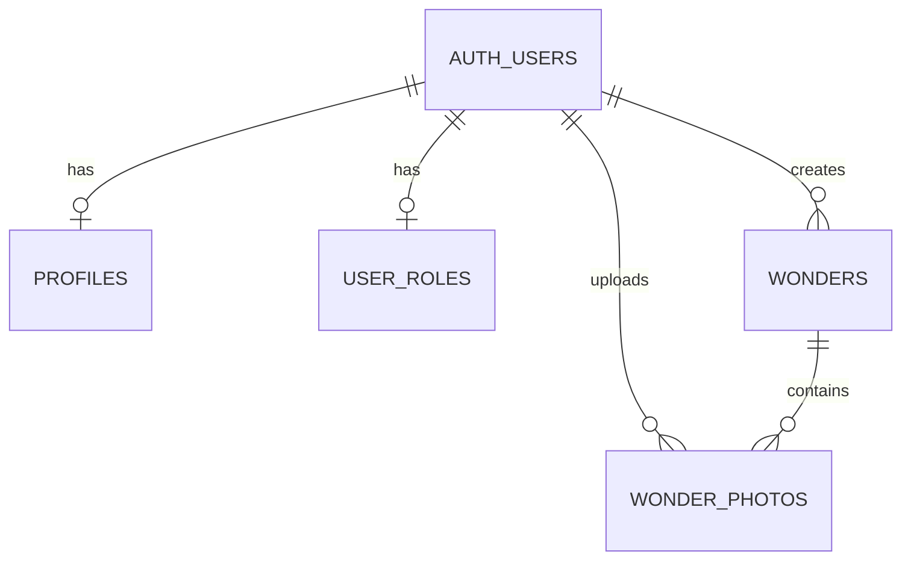

# Little Wonders

Little Wonders is a responsive multi-page web application for saving and celebrating the small moments that make life special.

Users can create and manage memories in four categories: Pets, Plants, Adventures, and Creations. They can also upload, view, and download photos associated with their memories.

This application was developed as a capstone project for the SoftUni AI course "Software Technologies with AI".

## Live Application

**Live website:** https://little-wonders-delta.vercel.app/

**GitHub repository:** https://github.com/monika-hyperisland/little-wonders

## Features

- User registration, login, and logout
- User authentication with Supabase Auth
- Create, view, edit, and delete wonders
- Four wonder categories: Pets, Plants, Adventures, Creations
- Photo upload, viewing, and download
- Private photo storage with Supabase Storage
- User and administrator roles
- Admin panel for managing community records
- Row-Level Security (RLS) for access control
- Responsive design for desktop and mobile devices
- Bootstrap styling and interactive UI elements

## Technologies

### Frontend
- HTML5
- CSS3
- JavaScript (ES modules)
- Bootstrap
- Vite

### Backend
- Supabase PostgreSQL Database
- Supabase Authentication
- Supabase Storage
- Supabase Row-Level Security

### Development and Deployment
- Node.js and npm
- Git and GitHub
- GitHub Copilot and AI-assisted development
- Vercel

## Architecture

Little Wonders uses a client-server architecture.

The frontend is built with vanilla JavaScript and Vite. It communicates with Supabase through the Supabase JavaScript client, which uses Supabase APIs.

Supabase provides the database, user authentication, file storage, and access control.

The application uses separate HTML pages and modular JavaScript files to keep presentation, data access, and application logic organized.

## Application Pages

| Page | File | Purpose |
|------|------|---------|
| Home | index.html | Introduction to Little Wonders |
| Register | register.html | Create a user account |
| Login | login.html | Sign in and sign out |
| My Wonders | wonders.html | View and manage personal wonders |
| Add Wonder | add-wonder.html | Create a new wonder and upload a photo |
| Edit Wonder | edit-wonder.html | Edit an existing wonder |
| Admin Panel | admin.html | Manage community wonders as an administrator |

## Database Design

The application uses four tables in the public Supabase schema.

### 1. wonders
Stores user-created memories.

Main fields:
- id
- user_id
- category
- title
- description
- created_at

### 2. profiles
Stores additional user profile information.

Main fields:
- id
- display_name
- created_at

### 3. wonder_photos
Stores information about uploaded wonder photos.

Main fields:
- id
- wonder_id
- user_id
- storage_path
- created_at

### 4. user_roles
Stores user roles for access control.

Main fields:
- user_id
- role
- created_at

Supported roles:
- user
- admin

### Database Relationships



`AUTH_USERS` represents the Supabase Auth users table (`auth.users`).

The schema uses foreign keys, indexes, and RLS policies. Database schema changes are maintained through SQL migration files in `supabase/migrations/`.

## Authentication and Authorization

Supabase Auth handles registration, login, logout, and user sessions.

New users automatically receive the `user` role.

Regular users can access and manage their own wonders.

Administrators have additional database permissions to view, edit, and delete wonders created by other users.

Supabase Row-Level Security policies enforce these permissions on the backend.

The Admin Panel also checks the current user's role before displaying administrative content.

## File Storage

Images are stored in the private Supabase Storage bucket:

`wonder-photos`

Files are organized using paths that include the user ID and wonder ID.

The application supports:
- Uploading images
- Displaying images through temporary signed URLs
- Downloading image files
- Storage access restrictions through RLS policies

Photo metadata is stored in the `wonder_photos` table.

## Project Structure

```text
little-wonders/
├── index.html
├── register.html
├── login.html
├── wonders.html
├── add-wonder.html
├── edit-wonder.html
├── admin.html
├── src/
│   ├── css/
│   │   └── style.css
│   ├── lib/
│   │   ├── supabase.js
│   │   ├── wonders.js
│   │   └── photos.js
│   ├── pages/
│   │   └── JavaScript modules for application pages
│   └── main.js
├── supabase/
│   ├── config.toml
│   └── migrations/
├── .github/
│   └── copilot-instructions.md
├── vite.config.js
├── package.json
└── README.md
```

## 💻 Local Development

### Prerequisites

- Node.js
- npm
- A Supabase project

### 1. Clone the repository

```bash
git clone https://github.com/monika-hyperisland/little-wonders.git
cd little-wonders
```

### 2. Install dependencies

```bash
npm install
```

### 3. Configure environment variables

Create a `.env.local` file in the project root.

```env
VITE_SUPABASE_URL=your_supabase_project_url
VITE_SUPABASE_PUBLISHABLE_KEY=your_supabase_publishable_key
```

Use the URL and publishable key from your Supabase project settings.

Never expose secret or service-role keys in frontend code.

### 4. Start the development server

```bash
npm run dev
```

Open the local address displayed in the terminal.

### 5. Create a production build

```bash
npm run build
```

The production files are generated in the `dist` directory.

## Deployment

Little Wonders is deployed through Vercel and connected to the GitHub repository.

The Vercel project uses:
- Framework preset: Vite
- Build command: `npm run build`
- Output directory: `dist`

The following environment variables are configured in Vercel:
- `VITE_SUPABASE_URL`
- `VITE_SUPABASE_PUBLISHABLE_KEY`

**Live URL:** https://little-wonders-delta.vercel.app/

## AI-Assisted Development

The project was developed using an iterative AI-assisted workflow:

1. Plan a small feature.
2. Use AI assistance to propose or implement changes.
3. Run the application.
4. Test the result.
5. Fix or improve the implementation.
6. Commit and push successful changes to GitHub.

GitHub Copilot was also used for a small visual improvement to the application's cards.

Project-wide AI agent instructions are stored in:

`.github/copilot-instructions.md`

## Testing

The following functionality has been tested during development:

- User registration and login
- User logout
- Creating, editing, and deleting wonders
- Administrator access to records created by other users
- Restricted access for regular users
- Uploading images to Supabase Storage
- Displaying and downloading images
- Responsive layouts on mobile
- Production build with Vite
- Login, image download, and Admin Panel access on the deployed website

## Demo Access

Demo account credentials are provided separately with the capstone project submission.

They are not included in this public repository.

## Course Capstone Project

Little Wonders was developed as a final capstone project for  Software Technologies with AI course at SoftUni AI.

The project demonstrates practical skills in web development,
Supabase integration, Git version control, and AI-assisted development.

